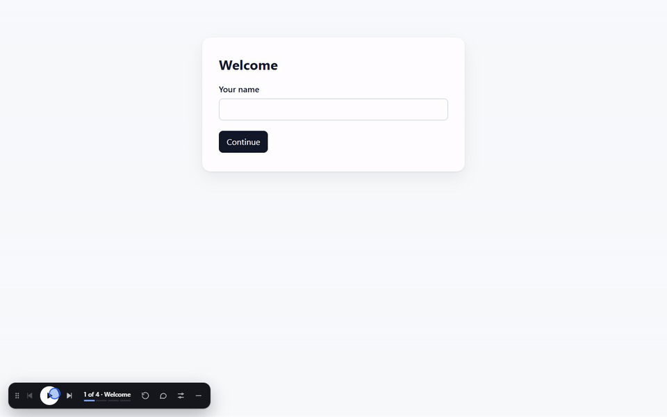

# prototype-controls

A Claude Code skill that puts a video-style player on top of a flow you're building, so you can see
every screen and every error state, and point at what to fix.



Run `/prototype-controls` on a flow and Claude adds a dark player bar to the page.

## Point at it, Claude fixes it

Press **💬**, click anything on the page, and write what should change. Pile up as many as you like
as you go through the flow: each waits as a draft (a dashed pin you can still edit or delete) until
you press **Send N** on the bar. They reach Claude Code together, as one list.

Each comment carries the step it's on, the element it's about and a slice of that element's HTML.
Claude finds the code from that, makes the change, replies on the pin and resolves it. That's the
difference from a screenshot in chat: a screenshot shows what's wrong, but Claude still has to work
out which step and which element. A comment says, and the reply tells you what changed.

A numbered pin marks each comment on the page. Hover it for a preview, click it for the thread, and
reply right there; your replies go to Claude too. All comments are listed in the panel, open or
resolved. Any other agent can read the same comments from a plain file.

## Every error state, one click away

The **⚗ panel** lists every error and edge state the flow has (a wrong code, a failed search, an
empty result), which Claude finds in the code when it sets the player up. Pick one and it goes
straight to that message and pauses there, so you can check its wording and design without working
out how to trigger it. Play carries on from it.

Errors Claude found but can't show from outside the flow are listed too, greyed, with the reason.

## Watch it play

- **Play** runs the flow by itself at a person's pace: it types into the real fields and clicks the
  real buttons. Long waits (a search that takes minutes) go by fast. Pacing problems, steps that drag
  and abrupt jumps show up when you watch, and they don't when you're clicking through quickly.
- **Pause** freezes the page like a paused video: timers, animations, everything. **Previous / next**
  move a step, **Replay** starts over, and **Speed** goes from 0.5× to 4×. The ⚗ panel also jumps to
  any step, so you can start at the one you're changing.
- **What if** switches the mock backend (slow, empty, failing), when the project has one.
- **Drag** the bar anywhere by its grip; it stays there. Double-click the grip to put it back.
  **Minimize** shrinks it to a round button with a progress ring.

## Review it

- **Check this screen** flags buttons with no name, images with no alt text, fields with no label,
  low contrast, and words your style guide rules out. **Timing** shows how long each step takes at 1×.
- The **studio** (`/__prototype/studio`) shows the flow at any size: drag the frame's edges or
  corner, type a width and height, or pick a device. A device bigger than the window is scaled to
  fit. It **records** a play-through to MP4 and **screenshots every step and every error** in one go:
  sharp, at 2× pixel density, taken in a headless Chrome of its own, so the frame stays free.
- The **flow review** (`/__prototype/sheet`) is every screen of the flow and every error, at any
  device size, in one page.
  Steps and errors in a list, the screen large in the middle, and when it changed since the last
  tour, side by side, a before/after slider, or the changes marked. Beside it: what the checks
  found, its comments and how long the step takes. Filter to what changed or needs checking, tick
  screens off as you review them, or see them all in a grid.

## Install

```bash
# Into a project (shared with everyone who clones it)
npx skills add sasura212/prototype-controls

# Just for you, in every project
git clone https://github.com/sasura212/prototype-controls ~/.claude/skills/prototype-controls
```

## Use

In Claude Code, with the flow built:

> /prototype-controls

That's all. Claude works out the flow's steps and every error state from the code, writes the
script, starts a dev server with the player on top, then plays the whole flow and opens every
error in a browser to check they work, fixing anything that doesn't. It starts watching for your
comments, and gives you the URL, the command to start it again, and a list of the errors it found,
including any it couldn't reach and why. Name the flow if you have more than one
(`/prototype-controls the checkout flow`).

To remove it, delete `.prototype/` and its line in `.git/info/exclude`.

## How it stays out of your code

Everything lives in a `.prototype/` folder at the repo root, listed in `.git/info/exclude`
(git's local-only ignore list, which is never committed). A small Vite config there loads your
project's own config and adds the player to the page, so you run a second dev server with the
player on top while your usual one carries on as normal. The player finds things by the text a
person reads, so the flow doesn't know it's there. Screenshots, recordings and comments are saved
in `.prototype/` too.

Nothing to clean up: the player never touches your flow's code, and git never sees it. Push your
flow and the player stays on your machine.

## Limits

- Vite projects only.
- It's local. Nothing about it is pushed, so a teammate who wants the player runs
  `/prototype-controls` themselves.
- The script is written for each flow, and a change to the UI can break a step (you rename a
  button, say). The player then shows what's on screen that looks like it. Pick one and it carries
  on; Claude folds the fix into the script later.
- Previous replays from the start to the step before (in seconds), since a page can't be wound back.
- Recording captures the tab with Chrome's screen-share prompt, once per session. Screenshots don't
  need it.
- Screenshot tours need Node 22+ and a Chrome or Edge installed (or `CHROME_PATH`).
- Pause and speed cover timers, `Date.now`, animation frames and CSS animations. `performance.now()`
  and `new Date()` aren't on the player's clock, so an animation that keeps its own time with them,
  as libraries like Framer Motion and GSAP can, won't speed up or slow down with the player, and may
  jump ahead when a pause ends.

## For other agents

Comments are in `.prototype/comments.jsonl`, one JSON event per line. `node .prototype/comment.mjs`
lists, shows, replies to, resolves and watches them; replies show on the comment's pin in the
browser. See the top of `templates/comment.mjs`.

## What's inside

| File                                    | What it is                                                                     |
| --------------------------------------- | ------------------------------------------------------------------------------ |
| `SKILL.md`                              | The steps Claude follows                                                       |
| `templates/overlay.ts` + `overlay.css`  | The player, the page's clock, and the ⚗ panel                                  |
| `templates/comments.ts` + `comment.mjs` | Comments on the page, and their store and command line                         |
| `templates/checks.ts`                   | Check this screen                                                              |
| `templates/studio.*` + `sheet.*`        | The studio and the flow review                                                 |
| `templates/tour.mjs`                    | The screenshot tour, in a headless Chrome of its own                           |
| `templates/vite.config.mjs`             | Adds the player to the page, and saves what it makes into `.prototype/`        |
| `templates/check-wait.js`               | What Claude runs in the browser to check each step and error                   |
| `templates/script.ts`                   | An example script                                                              |
| `test/`                                 | A small fixture flow, the dev-server security checks, a play-through, the demo |
| `package.json`                          | Dev dependencies (Vite, TypeScript) and the `check` and `test` scripts         |

## Development

`npm install`, then `npm run check` type-checks `templates/` and the fixture, and `npm test` runs the
security checks and plays the fixture in a headless Chrome (needs a Chrome or Edge, or
`CHROME_PATH`). GitHub Actions runs both on every push and pull request, and keeps the screenshots
when a run fails. `node test/demo.mjs` records the demo GIF again from the fixture (needs ffmpeg).

## License

MIT, see [LICENSE](LICENSE).
